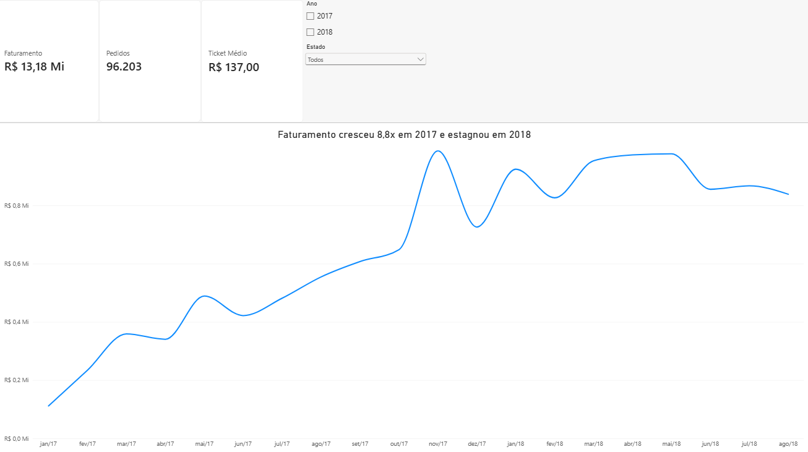
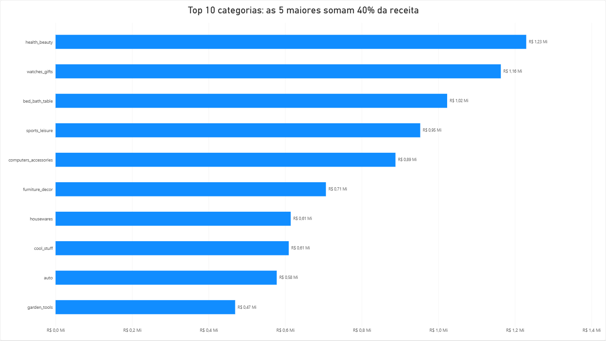
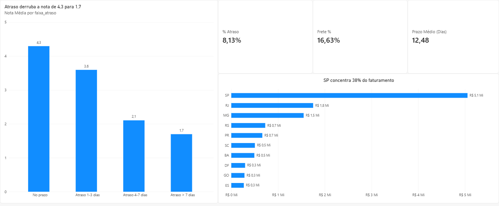

# Análise de e-commerce com SQL e Power BI

Este é um projeto de portfólio. Peguei uma base pública de um e-commerce brasileiro (a Olist, com cerca de 100 mil pedidos)
e fiz o papel de analista para responder duas perguntas: a empresa está crescendo de forma saudável e onde dá para melhorar?
Organizei e consultei os dados no MySQL, montei um dashboard no Power BI e escrevi as conclusões no [insights.md](insights.md).



## O que encontrei

Entre jan/2017 e ago/2018 a empresa faturou R$ 13,18 milhões em 96.203 pedidos entregues, com ticket médio de R$ 137.

- O faturamento de jan–ago/2018 foi 141% maior que o do mesmo período de 2017, mas o crescimento veio de mais pedidos: o ticket médio praticamente não mudou. Em 2018 o faturamento mensal ficou parado em torno de R$ 0,9 milhão e não superou o pico de novembro de 2017.
- 97% dos clientes compraram uma única vez, e mesmo entre os que deram nota 4 ou 5 só cerca de 4% voltaram.
- Cerca de 8% dos pedidos chegam atrasados, e a nota deles é bem menor: 1,7 nos atrasos acima de 7 dias, contra 4,3 nos pedidos no prazo. Isso é uma associação e não prova que o atraso causa a nota baixa. Testei também se o atraso reduz a recompra (script `05`): quem teve o primeiro pedido atrasado volta um pouco menos (3,2% contra 4,0%), mas a diferença é pequena. Os atrasos se concentram no Nordeste (chegam a 24% em Alagoas) e no Rio de Janeiro (13,5%, contra 5,9% em São Paulo).
- São Paulo, Rio de Janeiro e Minas Gerais respondem por cerca de 63% do faturamento.

O que eu recomendaria: cuidar dos atrasos e do prazo prometido ao cliente (começando pelo Rio e pelo Nordeste), tratar a retenção como um problema à parte, já que a recompra é baixa até entre clientes satisfeitos, e investigar por que o crescimento parou em 2018. A conclusão completa está no [insights.md](insights.md#conclusão-final).

## Perguntas que guiaram a análise

1. Quanto a empresa fatura e como isso evolui mês a mês?
2. Qual é o ticket médio e como ele varia?
3. Quais categorias e produtos sustentam a receita?
4. De onde vêm os clientes e quanto pesa o frete em cada região?
5. O atraso na entrega está ligado à satisfação do cliente?
6. Como os clientes pagam, e quantos voltam a comprar?

## Ferramentas

MySQL 8 (consultas com JOINs, CTEs e window functions), Power BI (modelo de dados, medidas em DAX e visuais) e GitHub.

## Base de dados

[Brazilian E-Commerce Public Dataset by Olist](https://www.kaggle.com/datasets/olistbr/brazilian-ecommerce), no Kaggle:
cerca de 100 mil pedidos de 2016 a 2018, em 9 tabelas. Os arquivos CSV não estão neste repositório, então é preciso baixá-los pelo link.

Os dados são públicos e foram disponibilizados pela Olist. A licença indicada para a base é a CC BY-NC-SA 4.0 (uso não comercial, com atribuição);
vale conferir na página do Kaggle. Este projeto tem fins educacionais e de portfólio.

## Como está organizado

```
├── sql/
│   ├── 01_criacao_tabelas.sql             # tabelas, chaves e importação
│   ├── 02_limpeza_validacao.sql           # checagens de qualidade dos dados
│   ├── 03_analises_kpis.sql               # análises de negócio
│   ├── 04_views_para_powerbi.sql          # views que alimentam o dashboard
│   └── 05_analise_hipotese_recompra.sql   # teste da hipótese sobre atraso e recompra
├── powerbi/
│   ├── dashboard.pbix
│   └── GUIA_DASHBOARD.md                  # medidas DAX e layout
├── images/                                # prints do dashboard
└── insights.md                            # conclusões e recomendações
```

## Como reproduzir

1. Baixe os CSVs do Kaggle e salve em uma pasta (por exemplo, `C:/olist/`).
2. Rode os scripts da pasta `sql/` em ordem, no MySQL Workbench. No `01`, ajuste o caminho dos arquivos.
3. Instale o MySQL Connector/NET na versão 8.0.x. O Power BI não reconheceu as versões mais novas.
4. Abra o `dashboard.pbix`, aponte para o seu servidor MySQL e atualize os dados.

## Dashboard

A primeira página traz faturamento, pedidos, ticket médio e a evolução mensal, com filtros de ano e estado.


A segunda mostra as 10 categorias que mais faturam.



A terceira reúne logística e clientes: nota por faixa de atraso, percentual de atrasos, peso do frete, prazo médio e faturamento por estado.



## Limpeza dos dados

Antes de analisar, rodei algumas checagens (script `02`). O que apareceu e o que decidi fazer:

| Verificação | Resultado | O que fiz |
|---|---|---|
| Status dos pedidos | 97,02% `delivered` (96.478 de 99.441) | O faturamento considera só pedidos entregues |
| Período | 2016 tem 329 pedidos em 3 meses; o fim da base é incompleto | Analisei de jan/2017 a ago/2018 |
| `delivered` sem data de entrega | 8 pedidos | Fora das views (por isso o dashboard mostra 96.203 pedidos e os KPIs do SQL, 96.211) |
| Entrega antes da compra | 0 | Nada a fazer |
| Pedidos sem itens | 775 | Ficaram de fora, pois não geram receita |
| Itens sem categoria | 1.603 (1,4%) | Agrupados como `sem_categoria` |
| Categorias sem tradução | 2 (`pc_gamer` e `portateis_cozinha_...`) | Inseri a tradução manualmente |
| Pedidos com mais de uma avaliação | 547 | Usei a média da nota por pedido |
| Preços zerados ou negativos | 0 | Nada a fazer |
| Valor pago diferente de itens + frete (mais de R$ 1) | 249 (0,25%) | Provavelmente juros e vouchers; o faturamento usa o preço dos produtos |
| `customer_id` muda a cada pedido | Um mesmo cliente tem vários `customer_id` | A recorrência usa o `customer_unique_id` |

## Dificuldades no caminho

- O `LOAD DATA LOCAL INFILE` deu o erro 2068 até eu habilitar `OPT_LOCAL_INFILE=1` na conexão do Workbench.
- O `review_id` não é único (547 pedidos têm mais de uma avaliação). Deixei a tabela sem chave primária e usei a nota média por pedido.
- O `customer_id` muda a cada pedido. Se eu o usasse para medir recompra, pareceria que ninguém volta a comprar; o `customer_unique_id` resolve isso.
- O conector MySQL do Power BI só funcionou com o Connector/NET 8.0.x.
- No DAX, criei uma coluna de ordem a partir de `faixa_atraso` e tentei ordenar `faixa_atraso` por ela, o que gerou uma dependência circular. Resolvi calculando a ordem a partir de `flag_atraso` e `dias_atraso`.
- O dashboard mostrou 8 pedidos a menos que o SQL. Investiguei e eram os pedidos entregues sem data de entrega, que as views excluem.
- Ao filtrar por ano, o eixo do gráfico não começava em zero e exagerava as variações. Fixei o mínimo em 0.

## Limitações

- A base não tem custo nem margem, então a análise fala de receita, não de lucro.
- Considerei só pedidos entregues, e o faturamento não inclui o frete.
- A relação entre atraso e nota é uma associação. Não dá para afirmar causa só com estes dados, e o teste de recompra não controla por categoria, estado ou preço.
- Os dados são anonimizados e vão de 2016 a 2018; os meses de 2016 e o fim da base ficaram fora dos indicadores principais.

## Autor

**João Paulo Santos** · [LinkedIn](https://www.linkedin.com/in/jpsanalista/)
